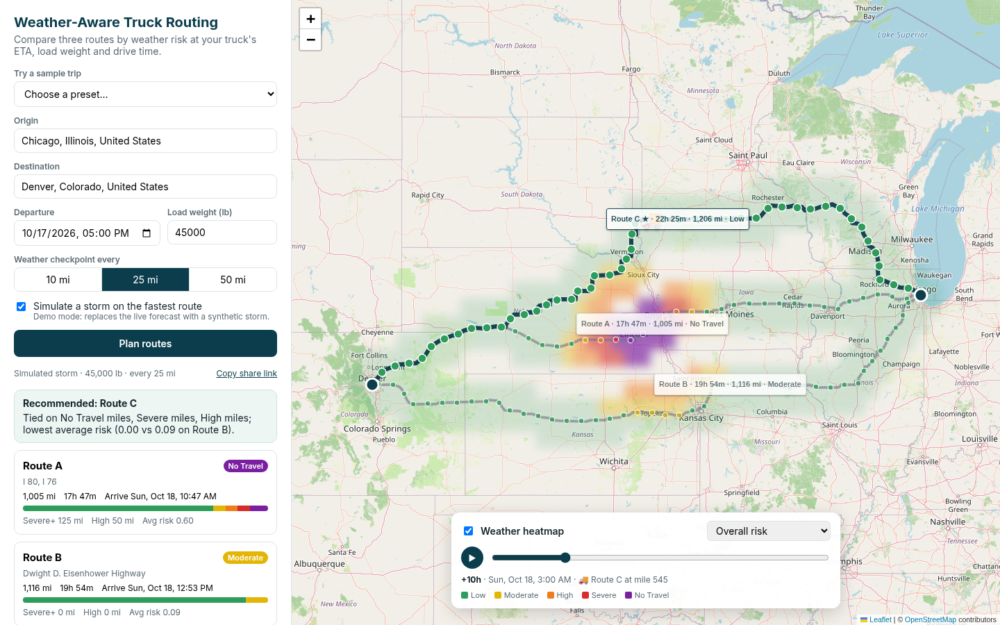

# Weather-Aware Truck Routing

A React + Django app that helps a truck driver pick the safest route. You enter an origin,
a destination, a departure time and a load weight. The app gets **three route options**,
checks the weather **at the time the truck will reach each checkpoint**, scores each
route with the risk and load rules from the brief, and **recommends one**. Everything is
shown on a map, with a **weather heatmap along the corridor** and a **0–48 h forecast slider**.

> Live demo: https://spotter-weather-routing.onrender.com (free tier, first load after idle can take ~50s) · Walkthrough: _add your Loom URL here_



## Features

- **3 routes** from OSRM, the fastest first. OSRM often returns only 1–2 alternatives, so
  the app fills the gap by routing through via-points to either side of the fastest route
  and drops near-duplicates (more than 80% shared road) and detours over 1.6× slower.
  On short trips there may be fewer than three sensible routes. The app then shows the
  ones it found rather than inventing a silly detour.
- **Checkpoints every 10, 25 or 50 miles** (you choose). Each one gets an ETA from
  departure plus truck-adjusted drive time, and the forecast for **that hour** at
  **that place** (Open-Meteo, hourly).
- **Risk rules exactly as specified**: wind, rain and snow bands, the worst condition wins,
  then the load rules (>30,000 lb and >40,000 lb) can raise wind risk. Each checkpoint
  says *why* it got its level, e.g. "Wind 40.0 mph (High) → Severe with 45,000 lb load".
- **Recommendation** in the brief's order: fewest Severe miles → fewest High miles →
  lowest average risk → shortest time. A sentence explains which criterion decided it.
- **Map**: all three routes with permanent summary labels (time · distance · worst risk),
  checkpoints coloured by risk with popups (ETA, wind/gusts, rain, snow, temperature,
  reasons). Click a route or card to select it; click a table row to fly to a checkpoint.
- **Corridor heatmap** with a 0–48 h slider and a play button. Layers: overall risk,
  load-adjusted wind, rain or snow. A 🚚 marker shows where the selected route's truck
  is at the slider hour, so you can watch it drive into (or around) the weather.
- **Simulated storm** demo mode, because the live forecast is often calm. It puts a storm
  cell on the fastest route's midpoint at the moment the truck gets there.
- **Shareable plans**: every plan is saved; `?plan=<id>` reopens it.
- **Seed presets**: six sample trips (four live, two simulated storms) in one click.

## Stack

| Layer | Choice | Why |
|---|---|---|
| Backend | Django 5.2 + Django REST Framework | Asked for in the brief |
| Frontend | React 19 + TypeScript + Vite | Asked for in the brief |
| Map | Leaflet + react-leaflet, OpenStreetMap tiles | Free, light, canvas renderer for many markers |
| Routing | [OSRM](https://project-osrm.org/) public server | Free, no key, returns alternatives and per-segment durations |
| Weather | [Open-Meteo](https://open-meteo.com/) | Free, no key, hourly, many locations per request |
| Geocoding | [Photon](https://photon.komoot.io/) (OSM) | Free, no key, made for type-ahead |
| DB | SQLite locally, Postgres in production (`DATABASE_URL`) | |
| Cache | Django cache (locmem, or Redis with `REDIS_URL`) | Weather, routes and geocoding |

No API keys are needed.

## Run it locally

Requirements: Python 3.12+, Node 20+.

```bash
make setup     # venv + pip install, npm ci
make seed      # migrate + load demo presets
make api       # terminal 1: Django on http://localhost:8000
make web       # terminal 2: Vite on http://localhost:5173 (proxies /api)
```

Open http://localhost:5173, pick **"Demo: blizzard on I-80 (simulated)"** and press **Plan routes**.

Without `make`:

```bash
cd backend && python3 -m venv .venv && . .venv/bin/activate
pip install -r requirements-dev.txt
python manage.py migrate && python manage.py seed_presets
python manage.py runserver
# new terminal
cd frontend && npm ci && npm run dev
```

**One-process production-style run**: `make build`, then `make api` and open
http://localhost:8000. Django serves the React build through WhiteNoise.

### Tests

```bash
make test   # pytest (67 tests) + vitest (9 tests)
make lint   # ruff + oxlint + tsc
```

Backend tests cover every risk band edge, the load rules, checkpoint spacing and ETAs,
the ranking order and its tie-breaks, route gap-filling and de-duplication, Open-Meteo
batching, snapping, slicing and caching (HTTP mocked with `responses`), the full planning
pipeline with fake providers, and the API (validation, 502 on upstream failure, sharing).

## Deploy

The repo is one Docker image: Node builds the frontend, then Python serves the API and the
static build with gunicorn. `start.sh` runs migrations and seeds the presets on boot.

- **Render** (free): New → Blueprint → pick this repo. `render.yaml` creates the web
  service and a free Postgres database and generates `DJANGO_SECRET_KEY`.
- **Anywhere with Docker**: `docker build -t truck-routing . && docker run -p 8000:8000 -e DJANGO_SECRET_KEY=... -e DJANGO_ALLOWED_HOSTS=your.host truck-routing`

| Env var | Default | Purpose |
|---|---|---|
| `DJANGO_SECRET_KEY` | — (required when `DJANGO_DEBUG=false`) | |
| `DJANGO_DEBUG` | `true` (`false` in Docker) | |
| `DJANGO_ALLOWED_HOSTS` | `localhost,127.0.0.1` (+ Render host automatically) | |
| `DATABASE_URL` | SQLite file | Postgres in production |
| `REDIS_URL` | unset → in-memory cache | Share the cache across workers |
| `TRUCK_MAX_SPEED_MPH` | `65` | Speed cap applied to OSRM's car timings |
| `OSRM_BASE_URL` | public demo server | Point at your own OSRM (truck profile) |
| `PLAN_RATE_LIMIT` | `60/hour` | Per-IP limit on creating plans |

## Architecture

```
frontend/ (React)                         backend/ (Django)
┌───────────────────────┐   POST /api/plans/   ┌──────────────────────────────────────┐
│ TripForm              │ ───────────────────▶ │ views.PlanList  (validate, save)      │
│ RouteCards            │                      │   └─ planner.plan_trip                │
│ CheckpointTable       │ ◀─────────────────── │       ├─ services/routing   → OSRM    │
│ MapView               │   plan JSON          │       ├─ build_checkpoints (ETAs)     │
│  ├ routes + labels    │   (routes,           │       ├─ services/weather → Open-Meteo│
│  ├ checkpoint markers │    checkpoints,      │       ├─ risk.assess (rules)          │
│  ├ CorridorHeatLayer  │    heatmap frames)   │       ├─ summarize + ranking_key      │
│  └ truck marker       │                      │       └─ heatmap.build (49 frames)    │
│ ForecastPanel (slider)│   GET /api/geocode/  │ services/geocoding  → Photon          │
└───────────────────────┘   GET /api/presets/  └──────────────────────────────────────┘
```

Backend modules (all in `backend/trips/`):

- `risk.py` – the rules table and load rules. Pure functions, no Django.
- `services/routing.py` – OSRM calls, truck speed cap, gap-filling with via-point detours, overlap check.
- `services/weather.py` – `OpenMeteoProvider` (batching, grid snapping, caching) and `SimulatedStormProvider`. Both return hourly series.
- `planner.py` – the pipeline: checkpoints → weather at ETA → risk → per-route stats → ranking → explanation.
- `heatmap.py` – picks corridor grid cells and computes risk levels for every slider hour.
- `views.py`, `serializers.py`, `models.py` – thin API layer. `TripPreset` (seed data) and `TripPlan` (saved results).

API:

| Method | Path | |
|---|---|---|
| `POST` | `/api/plans/` | Body: `origin`, `destination` (`{label, lat, lon}`), `departure` (ISO 8601), `load_lb`, `interval_miles` (10/25/50), `simulate_storm` |
| `GET` | `/api/plans/<id>/` | A saved plan |
| `GET` | `/api/plans/` | 10 most recent plans (no results) |
| `GET` | `/api/presets/` | Demo trips |
| `GET` | `/api/geocode/?q=` | Place search |
| `GET` | `/api/health/` | |

## How the logic works

**ETAs.** OSRM gives a duration for every tiny road segment. OSRM's public server only
has a car profile, so each segment is slowed to at most 65 mph (a typical truck speed
governor). A checkpoint's ETA is departure plus the summed time up to that point. Rest
breaks (HOS rules) are not modelled; see *Improvements*.

**Weather at the ETA.** Each checkpoint takes the forecast for the hour nearest its ETA.
Rain is Open-Meteo `rain + showers` (in/hr), snow is `snowfall` (in/hr), wind is the
sustained 10 m wind in mph. Gusts are shown but not scored, because the brief's table
gives one wind value and sustained wind is the usual basis for truck restrictions.

**Risk.** Each condition maps to a band. Where the brief's ranges touch (rain
0.10–0.25 and 0.25–0.50), a value on the boundary goes to the higher band. The brief is
explicit that rain/snow No Travel is *above* 1.00 / 3.0, so exactly 1.00 in/hr is Severe.
Load rules apply to wind only: Severe wind + >30,000 lb → No Travel; High wind +
>40,000 lb → Severe. The checkpoint level is the worst of wind, rain and snow.

**Miles per level.** A checkpoint stands for the road halfway to each neighbour, so the
miles always add up to the route length and the result doesn't depend on where the
sampling starts. Average risk is the mileage-weighted mean on a 0–4 scale.

**Ranking.** Sort by (No Travel miles, Severe miles, High miles, average risk, time):

- No Travel miles go first. The brief starts at "fewest Severe miles", but a route through
  No Travel weather must never beat one that only has Severe weather.
- Miles are compared to the nearest mile and average risk to one decimal. Without this, a
  few miles of Moderate wind (average 0.02 vs 0.00) would send a driver on a route four
  hours longer. Rule 4 (time) only matters when the risk is effectively equal, and this
  is what makes "balancing weather risk and travel time" work in practice.

**Heatmap.** The corridor is every grid cell within 40 miles of any route. The grid gets
coarser on long trips (0.2° up to 1.5°) to stay at 400 cells or fewer. The API sends all
49 hours at once, one risk digit per cell per layer (`"0012…"`), so a whole 1,000-mile plan is
about 160 KB of JSON, 20–30 KB gzipped, and the slider never waits on the network. The frontend draws the
cells as rectangles on one canvas with a CSS blur. Route and checkpoint layers are
memoised, so a slider step only redraws that canvas. In headless Chrome one step
(React render + redraw) takes about 0.5 ms; before memoising it was about 16 ms.

## Decisions and tradeoffs

- **Free, keyless APIs** so reviewers can run it without signing up. The cost is that
  OSRM has no truck profile (no bridge heights, weight limits or hazmat). Set
  `OSRM_BASE_URL` to your own OSRM with a truck profile, or swap in OpenRouteService
  `driving-hgv`, by changing only `services/routing.py`.
- **Synchronous planning (~4–7 s cold, less when cached)** instead of a job queue. One
  request, simple to follow. Weather calls run in parallel threads and are cached for 30 min.
- **Grid snapping (0.1° for checkpoints)** cuts weather calls a lot. Open-Meteo's model
  resolution is a few km, so very little accuracy is lost.
- **Whole result stored as JSON** on `TripPlan`. Plans are read-only snapshots, so a
  normalised schema would add joins without a benefit.
- **Departure limited to the next 7 days**, where hourly forecasts are still useful.
- **One deployable**: Django serves the React build. No CORS setup, one URL to share.

## Improvements with more time

- Hours-of-service rest stops in ETAs (11 h driving / 30 min break).
- A truck routing profile (weight, height and hazmat restrictions).
- "Leave later" suggestions: run the same routes at +2/+4/+8 h and show the safest departure.
- Gust-aware wind scoring and road-surface signals (freezing rain, visibility).
- Stream results (routes first, weather after) with a background worker and SSE.
- Vector tiles / WebGL heatmap for continental-scale corridors.
- End-to-end browser tests in CI (a Playwright smoke test was run by hand during development).
